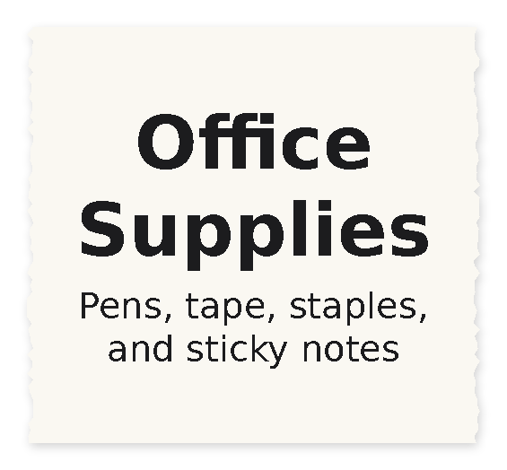
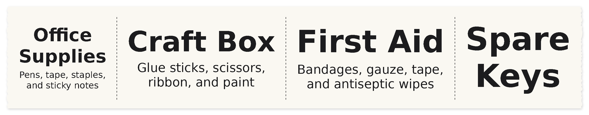

# ppa6

A command-line tool for printing on a PeriPage A6 thermal printer from Linux over Bluetooth. It prints dense text notes, organizer labels, and images, and its layouts are defined by profiles you can change or write yourself.


## Requirements

- Linux with Bluetooth and `bluetoothctl` (BlueZ)
- The system Python 3.11+ (`/usr/bin/python3`). Python's Bluetooth sockets (`AF_BLUETOOTH`) are often missing from pyenv and virtualenv builds, so the script switches to the system interpreter on its own when needed.
- Pillow (`sudo apt install python3-pil`)
- DejaVu fonts (`sudo apt install fonts-dejavu-core`); Liberation fonts work as a fallback

No PyBluez is needed; the script uses the standard library's RFCOMM sockets.

## Getting started

Turn the printer on and find its address:

```sh
./ppa6.py find
```

Pass the address with `-m` each time, or set it once in your shell profile:

```sh
export PERIPAGE_MAC=XX:XX:XX:XX:XX:XX
./ppa6.py info      # name, firmware, serial, battery
```

## Commands

| Command | What it does |
| --- | --- |
| `find` | Scan for PeriPage printers and print their addresses |
| `info` | Show the printer's name, firmware, serial number, and battery level |
| `profiles` | List layout profiles and the fields each one accepts |
| `print` | Print records using a layout profile (see below) |
| `text FILE` | Print a text file as dense monospace text; same as `print -p dense -i FILE` |
| `image FILE` | Print an image, scaled to the paper width and dithered (`--no-dither` for a hard threshold) |
| `feed [STEPS]` | Feed paper |

Global options go before the command: `-m MAC` sets the printer address and `-d 0|1|2` sets the darkness (light, medium, dark).

## Printing with profiles

```sh
# Inline values, filled into the fields in order
./ppa6.py print -p label "Office Supplies" "Pens, tape, staples, and sticky notes"
```



```sh

# From a file: one label per blank-line-separated block
./ppa6.py print -p label -i examples/labels.txt

# Piped in
cat examples/labels.csv | ./ppa6.py print -p label

# Change a setting for one run, and render to an image instead of printing
./ppa6.py print -p label -i examples/labels.txt -o length=60 -o title.font=serif-bold --preview out.png
```


`--preview OUT.png` renders without connecting to the printer and reports how much paper the job would use. The image is the exact black-and-white output the printer gets. Sideways (landscape) profiles are previewed upright so they're easy to read.

### Input formats

Input can come from inline values, from a file with `-i FILE`, or from stdin. The format is picked from the file extension or the content; use `-f text|csv|tsv|json` to set it yourself.

**Plain text.** Blank lines separate records. The first line fills the first field, the second line the second field, and any extra lines are added to the last field. A block can also name its fields with `field: value` lines, using a field's name or any of its aliases:

```text
Office Supplies
Pens, tape, staples, and sticky notes

title: First Aid
desc: Bandages, gauze, tape, and antiseptic wipes

Spare Keys
```

**CSV or TSV.** A header row of field names is optional. Without one, columns fill fields in order.

```csv
name,contents
Office Supplies,"Pens, tape, staples, and sticky notes"
```

**JSON.** An object, or a list of objects, arrays, or strings:

```json
[
  {"title": "Office Supplies", "description": "Pens, tape, staples, and sticky notes"},
  ["Craft Box", "Glue sticks, scissors, ribbon, and paint"],
  "Spare Keys"
]
```

A record can leave out later fields. A label with no description just gets a bigger name.

## Built-in profiles

Profiles live in `profiles/`. Run `./ppa6.py profiles` to list them.

### `label`

Printed sideways, so the container name can use the full 48mm paper width as its height. The label length fits the name, between 50 and 90mm. Labels in a batch are separated by dashed cut lines. Fields: `title` (aliases `name`, `container`) and `description` (aliases `desc`, `contents`).

Add an outline with `-o border=3`:


### `tag`

Printed upright, 48mm wide with a rounded border, for narrow drawer fronts. Same fields as `label`.


### `dense`

Preformatted monospace text, sized so the longest line just fits across the paper, for getting as much text as possible onto as little paper as possible. The whole input is one record. `ppa6.py text FILE` uses this profile.


### Things to know

- **Matching sizes in a batch.** `label` and `tag` set `uniform = true`, which shrinks each field to the same size across a batch so a set of organizer labels matches. One long name makes every name in that batch smaller; print it separately, or pass `-o uniform=false`. The top image in this README uses `uniform`; this is the same batch without it:

  

- **Long names.** In `label`, a long name wraps onto a second line when that lets it print larger than it would on one line within the 90mm limit:

  

- **Darkness.** Both label profiles print at darkness 2 (dark). Pass `-d 1` or `-o darkness=1` if large text bleeds.

## Writing your own profile

A profile is a TOML file. Copy one of the built-ins into `~/.config/ppa6/profiles/` and edit it; a profile there overrides a built-in with the same name. You can also pass a path directly: `-p ./my-profile.toml`. `profiles/label.toml` explains every setting in comments.

Any setting can be changed for one run with `-o KEY=VALUE`, or `-o FIELD.KEY=VALUE` for one field. Setting a field key at the top level of a profile makes it the default for every field.

Printer dots are 8 per mm (203 dpi), and the printable width is 384 dots (48mm).

### Profile settings

| Key | Default | Meaning |
| --- | --- | --- |
| `description` | `""` | Shown by `ppa6.py profiles` |
| `orientation` | `portrait` | `portrait`: text runs across the paper and the label grows downward. `landscape`: text runs along the paper and the label is 48mm tall. |
| `length` | `0` | Fixed label length in mm along the paper; `0` fits the content |
| `min_length` / `max_length` | `0` | Limits in mm when `length = 0`; `max_length = 0` means no limit |
| `margin` | `2` | Margin in mm; `margin_x` and `margin_y` set each axis separately |
| `gap` | `1` | Space in mm between fields |
| `valign` | `center` | `top`, `center`, or `bottom`, when the label has spare height |
| `border` | `0` | Outline width in dots; `0` means no outline |
| `border_radius` | `0` | Outline corner radius in mm |
| `batch` | `true` | Input may hold several records; `false` treats the whole input as one |
| `uniform` | `false` | Shrink each field to its smallest size in the batch |
| `cut_line` | `true` | Dashed cut line between records in a batch |
| `spacing` | `4` | Space in mm between records in a batch |
| `darkness` | `-1` | `0` to `2`; `-1` leaves the printer's setting alone. `-d` overrides it. |
| `dither` | `false` | Dither instead of a hard black/white threshold |
| `feed` | `96` | Motor steps of paper fed after the job |

### Field settings

Each `[[fields]]` table is one field, drawn top to bottom in the order listed.

| Key | Default | Meaning |
| --- | --- | --- |
| `name` | (required) | Field name used in keyed input |
| `aliases` | `[]` | Other names accepted in keyed input |
| `font` | `sans` | `mono`, `sans`, `condensed`, or `serif`, each with a `-bold` variant; a font file path; or any name `fc-match` understands, like `"Noto Sans:bold"` |
| `size` | `0` | Fixed font size in dots; `0` picks the largest size that fits |
| `min_size` / `max_size` | `8` / `0` | Range for automatic sizing; `max_size = 0` means as large as fits |
| `max_ratio` | `0` | Never larger than this fraction of the previous field's size, to keep a clear hierarchy |
| `weight` | `1` | Share of the label height when the height is fixed, relative to other fields |
| `wrap` | `false` | Word-wrap to the label width |
| `max_lines` | `0` | Line limit; `0` means unlimited. Text that still doesn't fit at `min_size` is cut off with `…`. |
| `align` | `center` | `left`, `center`, or `right` |
| `line_spacing` | `1.0` | Line height multiplier |
| `preserve_spaces` | `false` | Keep runs of spaces, for preformatted text |

## Regenerating the README images

The images in `docs/images/` are real previews of the files in `examples/`, drawn onto a strip of paper. After changing a profile or the layout code, rebuild them with:

```sh
docs/make_images.py
```

## Project layout

```text
ppa6.py        the tool: printer driver, layout engine, and CLI
profiles/      built-in layout profiles
examples/      sample inputs for each format
docs/          README images and the script that builds them
personal/      your own print files (git-ignored)
apk/           the official app, kept locally for protocol research (git-ignored)
```

## Credits

The printer protocol comes from the reverse-engineering work in [bitrate16/peripage-python](https://github.com/bitrate16/peripage-python) (GPLv3) and was checked against the decompiled official PeriPage app.

## License

GPL-3.0-only. See [LICENSE](LICENSE).
