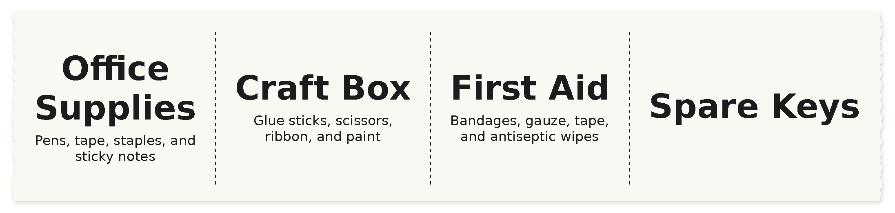
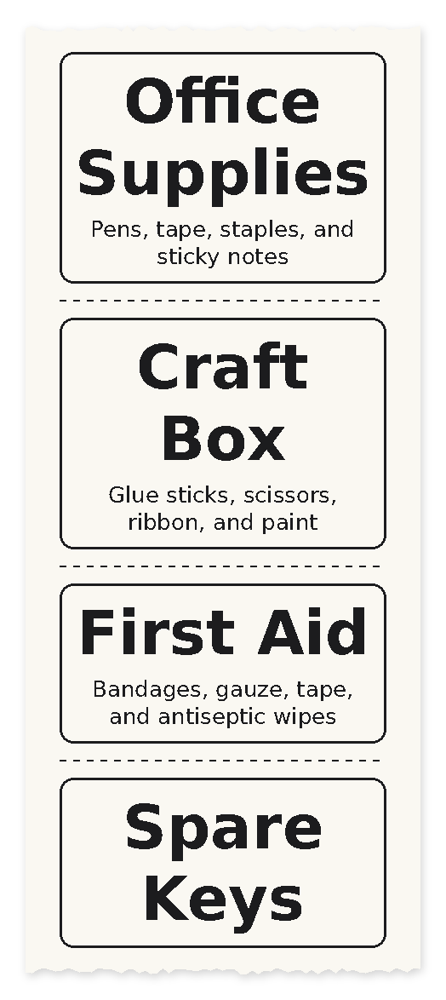
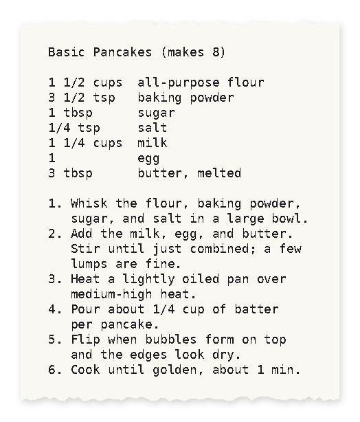

# ppa6

Print labels, notes, and images on a PeriPage A6 thermal printer from the Linux command line, over Bluetooth.



Layouts come from profiles: small TOML files that say what fields a print has (say, a container name and its contents) and how to style them. Feed in values inline, from a file, or through a pipe, and ppa6 sizes the text to fit.

## Requirements

- Linux with BlueZ (`bluetoothctl`)
- The system Python 3.11 or newer, at `/usr/bin/python3`
- Pillow: `sudo apt install python3-pil`
- DejaVu fonts: `sudo apt install fonts-dejavu-core`

Python builds from pyenv or virtualenvs often lack Bluetooth socket support, so ppa6 reruns itself with the system Python when it needs to. PyBluez isn't needed.

## Setup

Turn the printer on, find its address, and save it in your shell profile:

```sh
./ppa6.py find
export PERIPAGE_MAC=XX:XX:XX:XX:XX:XX
./ppa6.py info      # name, firmware, serial number, battery
```

You can also pass the address to any command with `-m`.

## Usage

```sh
# One label, with values filled into the profile's fields in order
./ppa6.py print -p label "Office Supplies" "Pens, tape, staples, and sticky notes"

# A batch of labels from a file, or piped in
./ppa6.py print -p label -i examples/labels.txt
cat examples/labels.csv | ./ppa6.py print -p label

# Render to an image instead of printing
./ppa6.py print -p label -i examples/labels.txt --preview out.png

# Change a profile setting for one run
./ppa6.py print -p label -o length=60 "Office Supplies"
```

`--preview` shows exactly the black-and-white image the printer would get, and how much paper the job uses.

| Command | What it does |
| --- | --- |
| `find` | Scan for PeriPage printers |
| `info` | Show the printer's name, firmware, serial number, and battery level |
| `profiles` | List profiles and the fields each one accepts |
| `print` | Print using a profile |
| `text FILE` | Print a text file as dense monospace text (same as `print -p dense -i FILE`) |
| `image FILE` | Print an image, dithered (`--no-dither` for a hard threshold) |
| `feed [STEPS]` | Feed paper |

Options before the command apply to all of them: `-m MAC` for the printer address, and `-d 0|1|2` for darkness (light, medium, dark).

### Input formats

The format is detected from the file extension or the content. Use `-f text|csv|tsv|json` to set it yourself.

**Plain text.** Blank lines separate records. Each line fills the next field, and extra lines are added to the last field. A block can also name its fields:

```text
Office Supplies
Pens, tape, staples, and sticky notes

title: First Aid
desc: Bandages, gauze, tape, and antiseptic wipes

Spare Keys
```

**CSV or TSV.** The header row of field names is optional:

```csv
name,contents
Office Supplies,"Pens, tape, staples, and sticky notes"
```

**JSON.** An object, or a list of objects, arrays, or strings:

```json
[
  {"title": "Office Supplies", "description": "Pens, tape, staples, and sticky notes"},
  ["Craft Box", "Glue sticks, scissors, ribbon, and paint"],
  "Spare Keys"
]
```

Later fields can be left out. A label with no description just gets a bigger name.

## Profiles

### `label`

For bins and boxes. Printed sideways, so the name can use the full 48mm paper width as its height. Each label is 50 to 90mm long, depending on the name, with dashed cut lines between labels.

Fields: `title` (or `name`, `container`) and `description` (or `desc`, `contents`).

All labels in a batch get the same text sizes, so a set matches; pass `-o uniform=false` to size each one separately. A long name wraps onto a second line when that makes it bigger:


### `tag`

For narrow drawer fronts. Printed upright, 48mm wide, with a rounded border. Same fields as `label`.



### `dense`

Fits as much text as possible on as little paper as possible. The whole input is printed as preformatted monospace text, sized so the longest line fits across the paper.



### Making your own

Copy a profile from `profiles/` into `~/.config/ppa6/profiles/` and edit it. A profile there replaces a built-in one with the same name. See the [profile reference](docs/profiles.md) for every setting.

## Development

`docs/make_images.py` rebuilds the images in this README from the files in `examples/`. Run it after changing a profile or the layout code.

`personal/` is git-ignored, for print files you don't want to commit.

Planned work is in [TODO.md](TODO.md).

## Credits

The printer protocol comes from the reverse-engineering work in [bitrate16/peripage-python](https://github.com/bitrate16/peripage-python), and was checked against the official PeriPage app.

## License

GPL-3.0-only. See [LICENSE](LICENSE).
