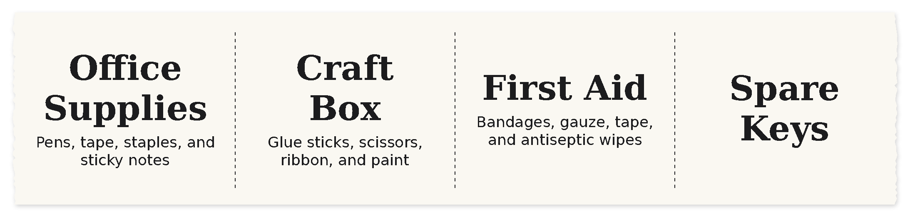

# Profile reference

A profile is a TOML file that lists a print's fields and how to lay them out. ppa6 looks for profiles in two places, in this order:

1. `~/.config/ppa6/profiles/`
2. `profiles/` next to `ppa6.py`

A profile in your config folder replaces a built-in one with the same name. You can also pass a path: `-p ./my-profile.toml`. `profiles/label.toml` has comments explaining each setting it uses, and makes a good starting point.

## Units

Lengths and margins are in millimeters. Font sizes and border widths are in printer dots: 8 dots per mm (203 dpi). The printable width is 384 dots, or 48mm.

## Changing settings for one run

`-o KEY=VALUE` overrides a profile setting, and `-o FIELD.KEY=VALUE` overrides a setting for one field. Values are read as TOML, so numbers, `true`/`false`, and lists work. Repeat `-o` for more than one override.

```sh
./ppa6.py print -p label -i examples/labels.txt -o length=60 -o title.font=serif-bold
```



```sh
./ppa6.py print -p label -o border=3 "First Aid" "Bandages, gauze, tape, and antiseptic wipes"
```


## Profile settings

| Key | Default | Meaning |
| --- | --- | --- |
| `description` | `""` | Shown by `ppa6.py profiles` |
| `orientation` | `portrait` | `portrait`: text runs across the paper, and the label grows as long as it needs. `landscape`: text runs along the paper, and the label is 48mm tall. |
| `length` | `0` | Label length in mm along the paper. `0` sizes it to fit: the content in portrait, or the first field in landscape. |
| `min_length`, `max_length` | `0` | Length limits in mm when `length = 0`. `max_length = 0` means no limit. |
| `margin` | `2` | Margin in mm. `margin_x` and `margin_y` set each axis separately. |
| `gap` | `1` | Space in mm between fields |
| `valign` | `center` | `top`, `center`, or `bottom`: where the text sits when the label has spare height |
| `border` | `0` | Outline width in dots. `0` means no outline. |
| `border_radius` | `0` | Outline corner radius in mm |
| `batch` | `true` | The input can hold several records. `false` treats the whole input as one record. |
| `uniform` | `false` | Give every record in a batch the same text sizes, by shrinking each field to its smallest size in the batch |
| `cut_line` | `true` | Dashed cut line between records in a batch |
| `spacing` | `4` | Space in mm between records in a batch |
| `darkness` | `-1` | `0` (light) to `2` (dark). `-1` leaves the printer's setting alone. The `-d` option overrides it. |
| `dither` | `false` | Dither instead of using a hard black/white threshold |
| `feed` | `96` | Paper fed after the job, in motor steps |

## Field settings

Each `[[fields]]` table is one field. Fields are drawn top to bottom in the order listed, and inline values and plain-text lines fill them in that order.

Setting a field key at the top level of a profile makes it the default for every field.

| Key | Default | Meaning |
| --- | --- | --- |
| `name` | required | Field name, used in keyed input (`name: value` lines, CSV headers, JSON keys) |
| `aliases` | `[]` | Other names accepted in keyed input |
| `font` | `sans` | `mono`, `sans`, `condensed`, or `serif`, each with a `-bold` variant; a font file path; or any name `fc-match` understands, like `"Noto Sans:bold"` |
| `size` | `0` | Fixed font size in dots. `0` picks the largest size that fits. |
| `min_size`, `max_size` | `8`, `0` | Range for automatic sizing. `max_size = 0` means as large as fits. |
| `max_ratio` | `0` | Never larger than this fraction of the previous field's size, to keep a clear hierarchy |
| `weight` | `1` | This field's share of the label height, relative to the other fields, when the height is fixed |
| `wrap` | `false` | Word-wrap to the label width |
| `max_lines` | `0` | Line limit. `0` means no limit. Text that still doesn't fit at `min_size` is cut off with `…`. |
| `align` | `center` | `left`, `center`, or `right` |
| `line_spacing` | `1.0` | Line height multiplier |
| `preserve_spaces` | `false` | Keep runs of spaces, for preformatted text |
